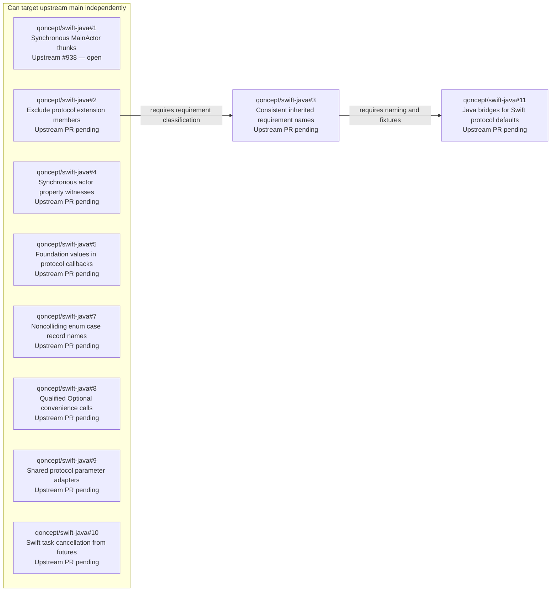

# Upstream PR dependencies

This fork collects fixes for contribution to
[swiftlang/swift-java](https://github.com/swiftlang/swift-java). This graph tracks
the prerequisites for submitting and merging those fixes **upstream**. It does
not describe PR bases, merge order, or merge status in `qoncept/swift-java`.

Snapshot: 2026-10-23. Upstream `main` is
[`301e3da`](https://github.com/swiftlang/swift-java/commit/301e3da710ede7af93e798f1ce1c7950715a5748).
Only fixes not yet merged upstream are included. Fixes are tracked primarily by
their **origin PRs in `qoncept/swift-java`**. Corresponding upstream PR numbers
and statuses are labeled separately. Documentation-only PRs are excluded; both
open and merged origin proposals can be tracked here.

## Dependency graph

An arrow points from a **prerequisite** to the **fix that requires it**. Fixes in
the left-hand group can each target upstream `main` independently. Each node is
identified by its origin PR; the arrows still represent upstream prerequisites.

## Origin tracking and upstream PRs

The source branches and commits identify each proposed patch; they do not add
dependencies to the graph.

| Origin PR (`qoncept/swift-java`) | ID | Scope | Upstream PR (`swiftlang/swift-java`) | Source branch | Source commit |
| --- | --- | --- | --- | --- | --- |
| [#1](https://github.com/qoncept/swift-java/pull/1) | `MAIN_ACTOR` | Preserve `@MainActor` isolation in synchronous JNI thunks and generic openers. | [#938](https://github.com/swiftlang/swift-java/pull/938) (open) | `codex/fix-jni-main-actor-thunks` | [`f6c879d`](https://github.com/qoncept/swift-java/commit/f6c879d5c3e43d23917ecffd2a6b9f3e1624efaa) |
| [#2](https://github.com/qoncept/swift-java/pull/2) | `PROTOCOL_EXT` | Distinguish protocol-body requirements from extension implementations when generating callback interfaces and boxes. | Not opened | `codex/fix-jni-protocol-extension-requirements` | [`12a26cd`](https://github.com/qoncept/swift-java/commit/12a26cd67e8e3052553ff54db856a822febb941b) |
| [#3](https://github.com/qoncept/swift-java/pull/3) | `PROTOCOL_NAMES` | Keep requirement names consistent across Java interfaces, inherited box methods, and JNI dispatch thunks. | Not opened | `codex/fix-jni-protocol-requirement-names` | [`c47f646`](https://github.com/qoncept/swift-java/commit/c47f64619346f418d9c278743b77ed2d8756ac19) |
| [#4](https://github.com/qoncept/swift-java/pull/4) | `ACTOR_PROPERTIES` | Preserve synchronous access to explicit `nonisolated` actor properties and immutable protocol getter witnesses. | Not opened | `codex/fix-jni-actor-property-witnesses` | [`07e66d9`](https://github.com/qoncept/swift-java/commit/07e66d937526eb957ce97cf083732ee61f70d002) |
| [#5](https://github.com/qoncept/swift-java/pull/5) | `FOUNDATION` | Bridge `Data`, `Date`, `URL`, and `UUID` through JNI protocol callbacks. | Not opened | `codex/fix-jni-foundation-callbacks` | [`06061b0`](https://github.com/qoncept/swift-java/commit/06061b09f87b90cb8f9fb555539748fc7cce26d3) |
| [#7](https://github.com/qoncept/swift-java/pull/7) | `ENUM_NAMES` | Avoid enum case record names that collide with enclosing Java types; keep payload accessors consistent. | Not opened | `codex/fix-jni-enum-case-name-collisions` | [`1e8ce49`](https://github.com/qoncept/swift-java/commit/1e8ce4963a09117396b00256234fe6d977413468) |
| [#8](https://github.com/qoncept/swift-java/pull/8) | `OPTIONAL_CALLS` | Qualify Optional convenience calls with `self` so generated parameters cannot shadow their target methods. | Not opened | `codex/fix-wrap-java-optional-method-calls` | [`6e80f20`](https://github.com/qoncept/swift-java/commit/6e80f208defe39e63967e59cf22a633403ff1214) |
| [#9](https://github.com/qoncept/swift-java/pull/9) | `PROTOCOL_ADAPTERS` | Reuse identical protocol-parameter adapters across overloaded initializers, methods, and free functions. | Not opened | `codex/fix-jni-protocol-parameter-overloads` | [`e133956`](https://github.com/qoncept/swift-java/commit/e1339562fa18c0364f68a67199e9374670180ca2) |
| [#10](https://github.com/qoncept/swift-java/pull/10) | `ASYNC_CANCEL` | Forward cancellation through generated result conversion to the Swift task, preserving legacy Future behavior. | Not opened | `codex/fix-jni-async-cancellation` | [`8c2c819`](https://github.com/qoncept/swift-java/commit/8c2c819aa6dd3196f4a62b4620a5a0233d991604) |
| [#11](https://github.com/qoncept/swift-java/pull/11) | `PROTOCOL_DEFAULTS` | Bridge supported Swift requirement defaults to Java interface default methods, including refinements and nested protocols. | Not opened | `codex/bridge-jni-protocol-default-methods` | [`08f9082`](https://github.com/qoncept/swift-java/commit/08f908272438d9d6e3e63a8421197bdd0fe6071b) |

## Why these dependencies exist

- **`PROTOCOL_EXT` → `PROTOCOL_NAMES`:** `PROTOCOL_EXT` introduces
  `ExtractedFunc.isProtocolRequirement` and filters
  `supportedProtocolRequirements(of:)` with it. `PROTOCOL_NAMES` builds its
  overload disambiguation and declaring-interface naming on that filtered set.
  Its patch requires `PROTOCOL_EXT`; it does not require `MAIN_ACTOR`.
- **`PROTOCOL_NAMES` → `PROTOCOL_DEFAULTS`:** the default bridge must preserve
  the declaring interface's requirement names across Java interfaces, returned
  boxes, native thunks, and callback forwarding witnesses. It reuses the naming
  regression fixtures introduced by origin #3, updating them for a Java default
  method and an explicit Java override. Origin #11 therefore requires origin #3
  for its current source and regression-test patch. Origin #2 is a transitive
  prerequisite: `protocolDefaultMethods(of:)` uses `isProtocolRequirement` to
  distinguish requirements from extension implementations. The graph omits the
  redundant direct edge from origin #2 to origin #11.
- **`MAIN_ACTOR` is independent:** it annotates synchronous thunks and generic
  openers and checks the caller's executor. It does not use the other fixes.
- **`ACTOR_PROPERTIES` is independent:** it adds
  `SwiftFunctionSignature.nonisolatedWitnessProtocol` and reads actor properties
  through that protocol. It uses neither the new protocol-requirement classifier
  nor the `MAIN_ACTOR` thunk changes.
- **`FOUNDATION` is independent:** it extends the existing callback conversions
  and adds the `JavaUtilUUID` runtime projection. It does not require protocol
  extension filtering, requirement-name changes, or either isolation fix.
- **`ENUM_NAMES` is independent:** it changes enum case record naming and
  associated payload accessor names. It does not use protocol callback or async
  task machinery.
- **`OPTIONAL_CALLS` is independent:** it changes `JavaClassTranslator`'s
  `wrap-java` Optional conveniences, independently of the `jextract` fixes.
- **`PROTOCOL_ADAPTERS` is independent:** it tracks identical generated wrapper
  declarations in `emittedProtocolParameterWrappers`, using protocol adapters
  already present upstream. Requirement classification, inherited naming, and
  default-method bridges are not prerequisites.
- **`ASYNC_CANCEL` is independent:** it adds `SwiftCompletableFuture`,
  `_JNIAsyncTask`, and cancellation forwarding to the existing JNI async lowering.
  The synchronous MainActor checks, actor property witness selection, and
  protocol fixes are not prerequisites.
- **`PROTOCOL_DEFAULTS` does not require origin #7–#10:** its native companions
  and receiver adapters have distinct helper names. It does not rely on the
  overload-adapter deduplication in origin #9 or the task runtime in origin #10.
  Its nested-interface projection, `Int`/`long` conversions, and refined-protocol
  forwarding witnesses are included in origin #11 itself. Foundation callback
  values from origin #5 are an additional capability, not a prerequisite for
  default bridges using the already-supported value types.

## Patch applicability checks

These relationships were checked against the source patches and the source
commits above. Each check starts with a temporary Git index containing upstream
`301e3da`. Prerequisites are applied with `git apply --cached`, followed by
`git apply --cached --check` for the proposed patch; the working tree is unchanged.

| Proposed origin patch | Prerequisites applied first | Result |
| --- | --- | --- |
| #1, #2, #4, #5, #7, #8, #9, #10 (each checked separately) | None | Pass |
| #3 | None | Does not apply |
| #3 | #2 | Pass |
| #11 | None | Does not apply |
| #11 | #2 only | Does not apply; the naming regression fixtures from #3 are absent |
| #11 | #2, then #3 | Pass |

Patch applicability supports the source analysis; shared context alone does not
create a semantic prerequisite. These checks are not a substitute for compiling
and testing each upstream submission. Regenerate bindings and run the relevant
Swift and Java tests after adapting each patch to its eventual upstream base.

## Upstream submission order

1. **Independent submissions:** `MAIN_ACTOR` (origin #1) is already submitted
   as upstream [#938](https://github.com/swiftlang/swift-java/pull/938), which is
   still open. Submit `PROTOCOL_EXT` (#2), `ACTOR_PROPERTIES` (#4), `FOUNDATION`
   (#5), `ENUM_NAMES` (#7), `OPTIONAL_CALLS` (#8), `PROTOCOL_ADAPTERS` (#9), and
   `ASYNC_CANCEL` (#10) against upstream `main` independently. They need not wait
   for #938 or for one another. Prioritize origin #2 to unblock the protocol
   naming/default chain; there is no required order among the other independent
   submissions.
2. **Requirement naming:** submit `PROTOCOL_NAMES` (origin #3) after the
   upstream equivalent of origin #2 merges.
3. **Protocol defaults:** submit `PROTOCOL_DEFAULTS` (origin #11) after the
   upstream equivalent of origin #3 merges. Origin #2 must already be present
   transitively. Origin #11 need not wait for origins #4, #5, or #7–#10.

If review should begin before prerequisites merge, submit the protocol work as
an explicit stack: origin #2's upstream equivalent targets `main`, origin #3's
upstream equivalent targets the #2 implementation branch, and origin #11's
upstream equivalent targets the #3 implementation branch. Keep each PR's diff
limited to its own change. After each prerequisite merges upstream, rebase the
next dependent branch onto upstream `main`, retarget its PR, and recheck the diff
and tests. A merge in `qoncept/swift-java` does not satisfy an upstream prerequisite.

Shared files and merge conflicts may require rebasing; they do not by themselves
create a prerequisite. When adding a fix, record its origin PR, corresponding
upstream PR (or pending status), descriptive ID, source commit, and the code-level
reason for every new edge. Update pending upstream PR links and statuses as
submissions progress. Merging a fix in this fork does not mark it merged upstream.
