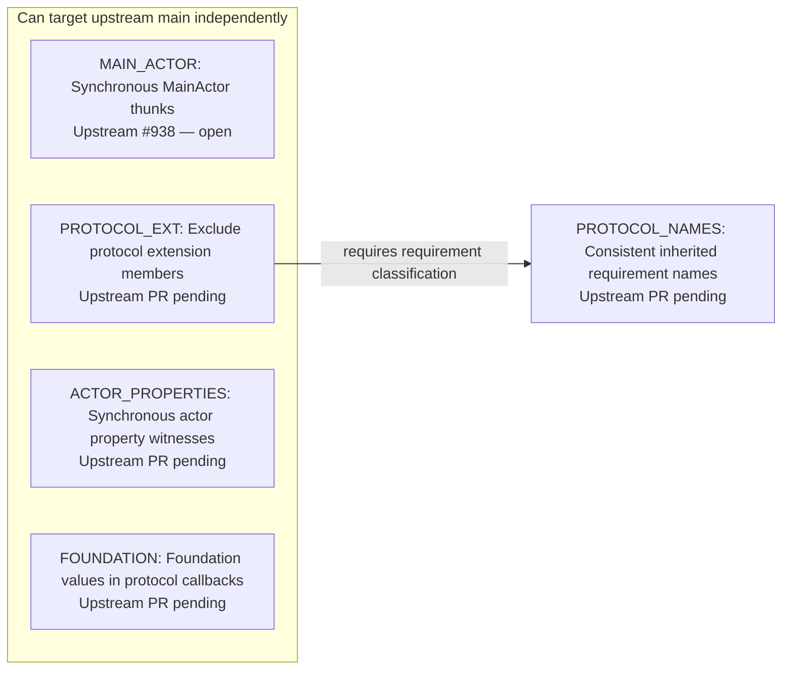

# Upstream PR dependencies

This fork collects fixes for contribution to
[swiftlang/swift-java](https://github.com/swiftlang/swift-java). This graph tracks
the prerequisites for submitting and merging those fixes **upstream**. It does
not describe PR bases, merge order, or merge status in `qoncept/swift-java`.

Snapshot: 2026-10-23. Upstream `main` is
[`301e3da`](https://github.com/swiftlang/swift-java/commit/301e3da710ede7af93e798f1ce1c7950715a5748).
Only fixes not yet merged upstream are included. All PR numbers below refer to
`swiftlang/swift-java`; fixes without an upstream PR use descriptive IDs.

## Dependency graph

An arrow points from a **prerequisite** to the **fix that requires it**. Fixes in
the left-hand group can each target upstream `main` independently.

## Fixes and upstream PRs

The source branches and commits identify each proposed patch; they do not add
dependencies to the graph.

| ID | Scope | Upstream PR | Source branch | Source commit |
| --- | --- | --- | --- | --- |
| `MAIN_ACTOR` | Preserve `@MainActor` isolation in synchronous JNI thunks and generic openers. | [#938](https://github.com/swiftlang/swift-java/pull/938) (open) | `codex/fix-jni-main-actor-thunks` | [`f6c879d`](https://github.com/qoncept/swift-java/commit/f6c879d5c3e43d23917ecffd2a6b9f3e1624efaa) |
| `PROTOCOL_EXT` | Distinguish protocol-body requirements from extension implementations when generating callback interfaces and boxes. | Not opened | `codex/fix-jni-protocol-extension-requirements` | [`12a26cd`](https://github.com/qoncept/swift-java/commit/12a26cd67e8e3052553ff54db856a822febb941b) |
| `PROTOCOL_NAMES` | Keep requirement names consistent across Java interfaces, inherited box methods, and JNI dispatch thunks. | Not opened | `codex/fix-jni-protocol-requirement-names` | [`c47f646`](https://github.com/qoncept/swift-java/commit/c47f64619346f418d9c278743b77ed2d8756ac19) |
| `ACTOR_PROPERTIES` | Preserve synchronous access to explicit `nonisolated` actor properties and immutable protocol getter witnesses. | Not opened | `codex/fix-jni-actor-property-witnesses` | [`07e66d9`](https://github.com/qoncept/swift-java/commit/07e66d937526eb957ce97cf083732ee61f70d002) |
| `FOUNDATION` | Bridge `Data`, `Date`, `URL`, and `UUID` through JNI protocol callbacks. | Not opened | `codex/fix-jni-foundation-callbacks` | [`06061b0`](https://github.com/qoncept/swift-java/commit/06061b09f87b90cb8f9fb555539748fc7cce26d3) |

## Why these dependencies exist

- **`PROTOCOL_EXT` → `PROTOCOL_NAMES`:** `PROTOCOL_EXT` introduces
  `ExtractedFunc.isProtocolRequirement` and filters
  `supportedProtocolRequirements(of:)` with it. `PROTOCOL_NAMES` builds its
  overload disambiguation and declaring-interface naming on that filtered set.
  Its patch requires `PROTOCOL_EXT`; it does not require `MAIN_ACTOR`.
- **`MAIN_ACTOR` is independent:** it annotates synchronous thunks and generic
  openers and checks the caller's executor. It does not use the other fixes.
- **`ACTOR_PROPERTIES` is independent:** it adds
  `SwiftFunctionSignature.nonisolatedWitnessProtocol` and reads actor properties
  through that protocol. It uses neither the new protocol-requirement classifier
  nor the `MAIN_ACTOR` thunk changes.
- **`FOUNDATION` is independent:** it extends the existing callback conversions
  and adds the `JavaUtilUUID` runtime projection. It does not require protocol
  extension filtering, requirement-name changes, or either isolation fix.

These relationships were checked against the source patches. The four
independent patches each pass `git apply --check` against upstream `301e3da`.
`PROTOCOL_NAMES` does not apply to that baseline alone, and passes the same check
after applying `PROTOCOL_EXT`. Patch applicability supports the source analysis;
it is not a substitute for compiling and testing each upstream submission.

## Upstream submission order

1. `MAIN_ACTOR` is already submitted as upstream #938. `PROTOCOL_EXT`,
   `ACTOR_PROPERTIES`, and `FOUNDATION` can each be submitted against upstream
   `main` without waiting for #938 or for one another.
2. Submit `PROTOCOL_NAMES` after `PROTOCOL_EXT` merges upstream, or submit it as
   a stacked PR with an explicit dependency on the upstream `PROTOCOL_EXT` PR.
   Keep the naming PR's diff limited to its own changes, then rebase onto
   upstream `main` and retarget after the prerequisite merges.

Shared files and merge conflicts may require rebasing; they do not by themselves
create a prerequisite. When adding a fix, record its upstream PR (or descriptive
ID), source commit, and the code-level reason for every new edge. Update pending
PR links and statuses as submissions progress. Merging a fix in this fork does
not mark it merged upstream.
